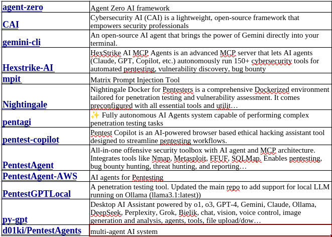

I look into open-source AI tools on GitHub that can assist me with different
cybersecurity activities. Here are some of them that I came across.

*Some of the tools I came across before narrowing the field.*

## AI Pentest Tool Examples

I am particularly interested in user-friendliness, features, functionality, and
modularity. The pros and cons of each tool depend largely on your specific use
case. For me, versatility is key, as I intend to use these tools for CTF
challenges, bug bounty programs, and penetration testing.

After exploring several options, I narrowed it down to
[CAI](https://github.com/aliasrobotics/cai) and
[PentAGI](https://github.com/vxcontrol/pentagi) as my two finalists.

In my opinion, CAI is more user-friendly and easier to set up, making it ready
for use immediately after installation. It is an excellent option for various
cybersecurity missions with minimal configuration.

PentAGI, on the other hand, is a more powerful tool with a broader range of
features. While I appreciate its capabilities, the setup process is more
complex, requiring multiple containers and orchestration. Proper configuration
is crucial to ensure PentAGI functions as intended. Once configured correctly,
it performs exceptionally well.

## Key takeaways

### PentAGI

- PentAGI is described as a fully autonomous AI-agent system for penetration
  testing. According to its GitHub repo, it runs in a sandboxed Docker
  environment, uses a suite of professional pentesting tools (nmap, Metasploit,
  sqlmap, and others), and can automatically plan and execute testing steps.
- It has a "smart memory system" to store past results and "web-intelligence"
  capabilities: a built-in browser/scraper plus external search integration to
  gather intelligence.
- PentAGI is mostly positioned as a tool for "security researchers, ethical
  hackers, and enthusiasts."

### Cybersecurity AI (CAI)

- CAI is an open-source AI framework for "Cybersecurity AI." You can build
  modular, agent-based workflows for tasks like reconnaissance, vulnerability
  discovery, exploitation, privilege escalation, lateral movement, and
  reporting.
- It supports many AI models — 300+, including options like Ollama — which gives
  flexibility depending on your setup or preferences.
- CAI has built-in guardrails (to control dangerous commands or prompt
  injection), logging and tracing, and a "human-in-the-loop (HITL)" mode —
  meaning you can pause or intervene in execution, which is safer when testing
  real or sensitive assets.
- CAI has already been evaluated academically: in one paper it claims to solve
  CTF challenges and real-world security tasks with significant efficiency gains
  over human testers (in certain categories).

*Originally published on [LinkedIn](https://www.linkedin.com/pulse/playing-ai-pentest-tools-bo-kaung-khz2c), December 5, 2025.*
