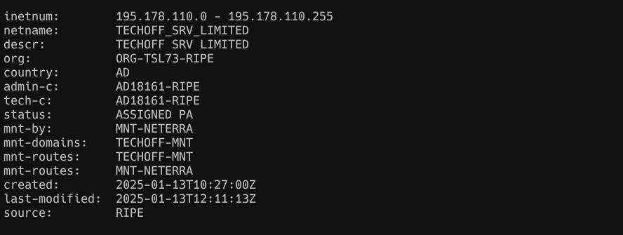
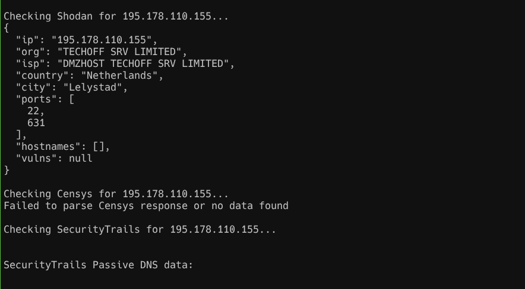
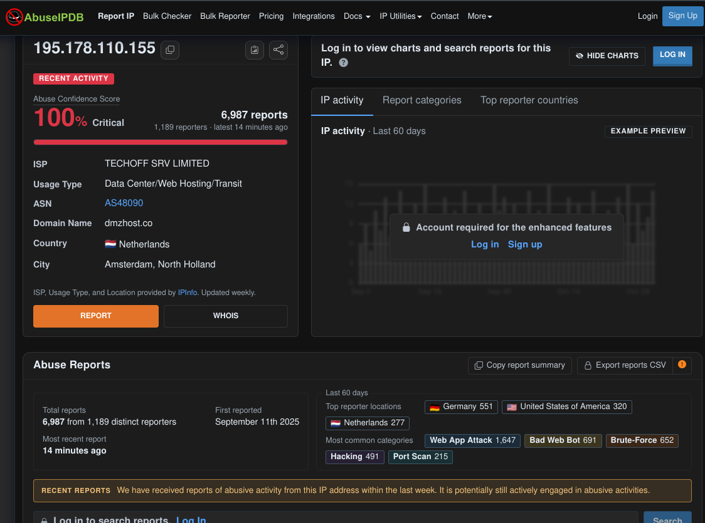

I used to own a WAF block list in AWS. The rules were simple: an allow list, a
block list, and a queue of addresses that belonged in one or the other. The
hard part was never the rule syntax. It was the sentence before the rule: *is
this address worth blocking?*

That sentence needs evidence. For a while I gathered it by hand — `whois`,
`dig`, three browser tabs of reputation pages — until I automated the
repetitive part into IP-Tracer, a shell script that runs the passive checks and
the reputation APIs and writes a timestamped report. This is one run against a
real address, and the verdict I would take to a change review.

## The claim and the verdict

The address is `195.178.110.155`.
[AbuseIPDB](https://www.abuseipdb.com/check/195.178.110.155) gives it a 100%
abuse confidence score. That number is not the interesting part. The
interesting part is what it supports.

| | |
|---|---|
| **Claim** | `195.178.110.155` belongs on the WAF block list |
| **Verdict** | Block the `/32` |
| **Confidence** | High that it is reported malicious and actively abusive; low on attribution and intent |
| **Evidence for** | 100% AbuseIPDB confidence; 6,987 reports all-time, 1,370 in 30 days; 15/94 VirusTotal engines on the root URL; 23/149 blacklist listings; reports minutes old |
| **Evidence against** | Hosting IP; no named incident report; two of five sources returned nothing; geolocation disagrees across four cities |
| **What would change it** | A whitelist entry, a new tenant, or our own WAF logs showing no malicious traffic |
| **What it does not prove** | Who is behind it, what they intended, or whether the address is malicious at this second |

## What I ran, and what I refused to run

Passive sources only: WHOIS and RDAP, reverse DNS, geolocation, five
threat-intelligence APIs, and OSINT. I did not ping, traceroute, or port-scan
the address. A public abuse report is not authorization to probe someone else's
host.

IP-Tracer now has a `--passive` flag for exactly this. It skips the active
sections and writes the reason into the report:

```text
Skipped in passive mode: active connectivity test not run
Skipped in passive mode: traceroute not run
Skipped in passive mode: nmap not run
```

Everything below came from passive sources or from what other people had
already observed.

## Ownership: what kind of host is this?

WHOIS and [RIPE RDAP](https://rdap.db.ripe.net/ip/195.178.110.155) agree on the
basics:

```text
inetnum:      195.178.110.0 - 195.178.110.255
netname:      TECHOFF_SRV_LIMITED
organisation: ORG-TSL73-RIPE
origin:       AS48090
country:      AD
status:       ASSIGNED PA
created:      2025-01-13
mnt-by:       MNT-NETERRA
```

Reverse DNS returns nothing. The published abuse contact is a free-mail address
rather than a provider role address.

None of that is a verdict. It tells me what kind of host this is: a hosting
allocation, not a residential connection, not a CDN edge, and not a Tor exit —
AbuseIPDB records `isTor: false`. Hosting matters because the address is one
tenant among many, and the provider, not the tenant, controls the range. It is
also why "block the `/32`, do not block the `/24`" is the only responsible
default.



*WHOIS/RDAP: a hosting allocation, AS48090, created in January 2025. Reverse DNS
is empty. Data as of 2026-10-31.*

## Reputation: many people watching the same address

AbuseIPDB is the loudest source. On the public page it reported **6,987 reports
from 1,189 distinct reporters**, first seen in September 2025, with the most
recent report minutes before I looked. The API the tool calls uses its **30-day
default** and returned **1,370 reports from 411 users**; the last report was
stamped `2026-10-31T18:00:25Z`. Those are the same address at two different
windows, not two different stories. Every number needs its window.

The categories are consistent with a host that scans and probes rather than one
that hosts a popular service: web app attack, bad web bot, brute force,
hacking, port scan. Reporters included WAF and CrowdSec users quoting request
paths such as `/wp-json`, `/telescope`, and `/forgot-password`.

[Third-party blacklist aggregators](https://i.pn/195.178.110.155) put the
address in **23 of 149 lists**, including Spamhaus DROP, FireHOL levels 1–4,
ET, and DShield.
[CleanTalk](https://cleantalk.org/blacklists/195.178.110.155) records spam
activity against **29 sites**, first seen 18 September 2025. None of these
are fully independent — blocklists share feeds — but the report is not an
AbuseIPDB artifact.

[VirusTotal](https://www.virustotal.com/gui/ip-address/195.178.110.155) is
quieter but specific. It recorded **15 detections out of 94 engines** for `http://195.178.110.155/` and `https://195.178.110.155/`, with
scans on 19 and 25 October. Those detections are on the bare IP root. URLs on
the historical hostname `am91cm5leq.fubohd.com` were undetected, and the
referrer samples were clean. The engines are flagging the address, not
everything it has ever served.

[Shodan](https://www.shodan.io/host/195.178.110.155) draws a different picture:
Lelystad, Netherlands; open ports **22 and 631**; no hostnames; no
vulnerabilities listed. VirusTotal observed HTTP and
HTTPS. Both can be true at different times. Shodan is a snapshot, not a live
scan, and a missing port is not a closed port.

Two sources said nothing. Censys returned a response the tool could not parse,
and SecurityTrails returned no usable data. The report prints a heading and
stops. I would rather see the error than a blank section, but a blank section is
still a finding: **not every clean-looking gap is a clean result.**



*Three sources, two silences: Shodan sees SSH and IPP; Censys and SecurityTrails
return nothing usable. Data as of 2026-10-31.*

## Where the sources disagree

Geolocation is the clearest disagreement. The same address is placed in four
cities and three countries:

| Source | Location |
|---|---|
| AbuseIPDB | Amsterdam, Netherlands |
| ipinfo.io | Amstelveen, Netherlands |
| Shodan | Lelystad, Netherlands |
| ip-api.com | Andorra la Vella, Andorra |
| RIPE registry | Andorra |
| VirusTotal | Bulgaria |
| CleanTalk | Bulgaria |

For a hosting address, this is normal and largely uninteresting: the provider's
registration, the datacenter, and the tenant's routing can all be different,
and geolocation services infer rather than observe. It matters only when
someone treats a map pin as evidence.

The exposure disagreement is more useful. Shodan sees SSH and IPP; VirusTotal
sees a web root that engines dislike. Neither is a live scan. The lesson is not
that one source is wrong. It is that each source answers a different question
at a different time.

Reputation has the same shape. AbuseIPDB is behavioral and loud. VirusTotal is
engine consensus and narrow. Censys and SecurityTrails are silent. A verdict
built on one of these is a verdict built on one angle.



*The score is the headline; the reporter count and categories are the evidence.
Data as of 2026-10-31.*

No vendor research post names this address. That absence is itself a finding:
this is commodity abuse with a long public record, not a documented campaign.

## The verdict, restated

Block the `/32`.

The confidence is high for "reported malicious and actively abusive," because
the reports are numerous, independent, recent, and behavioral. It is low for
"this specific person or group is attacking you," because an IP address is not
an identity, and reputation data cannot tell intent.

Three qualifications belong in the ticket:

1. **Do not block the `/24`.** The range belongs to a hosting provider;
   co-tenants have done nothing.
2. **Give the rule an expiry.** Reputation lags, tenants change, and a
   permanent block based on a snapshot is a permanent guess.
3. **Prefer the logs you already have.** In production, the WAF logs are the
   evidence that the address touched *you*. IP-Tracer tells you what the
   internet says about the address; it cannot tell you whether that address is
   in your traffic.

Concretely, I would scope the rule to the address, record the source and
capture time in the change ticket, and put a review date on it. If the address
reappears, that is a new data point. If the provider reassigns it, the rule is
stale and should go.

## What this does not prove

- **Attribution.** An address is not a person, a company, or a campaign.
- **Intent.** Scanning can be research, a bot, a compromised host, or a probe
  before an attack. The reports describe behavior, not motive.
- **Current state.** Reputation data lags and clusters. A report from minutes
  ago is strong; a report from last month is history.
- **Completeness.** Two of five sources returned nothing, and one of the three
  that answered saw the host at a different time than another.
- **Sufficiency.** A block is containment, not remediation. It does not patch
  the application, rotate a credential, or evict an intruder.

## How this fits the workflow

In production the IP report never stood alone. It joined WAF logs, other
intelligence, and an Amazon Q analysis agent that drafted the summary; a human
still made the rule change. The script's job was to make the first five minutes
of that review cheap: one command, one timestamped report, and a clear record of
what was not checked.

I keep it in Bash because it is light, portable, and fast: no runtime, nothing
to install beyond the tools already on a responder's machine, and the output is
a text file that can be attached to a ticket. The trade-off is that Bash is
poor at structured data, which is why the report is evidence for a human, not
an input to an automated blocker.

That is also why the report keeps its failures. A skipped section, an unparsed
response, and a disagreement between sources are not noise to be hidden. They
are the boundary of the claim.

## Try it

IP-Tracer is at [github.com/cicada-369/IP-Tracer](https://github.com/cicada-369/IP-Tracer).
If you run it against this address and a source I marked silent answers for
you, I want to know — especially if your evidence disagrees with mine.

---

*Data checked 2026-10-31. Reputation changes; re-check before acting.*
